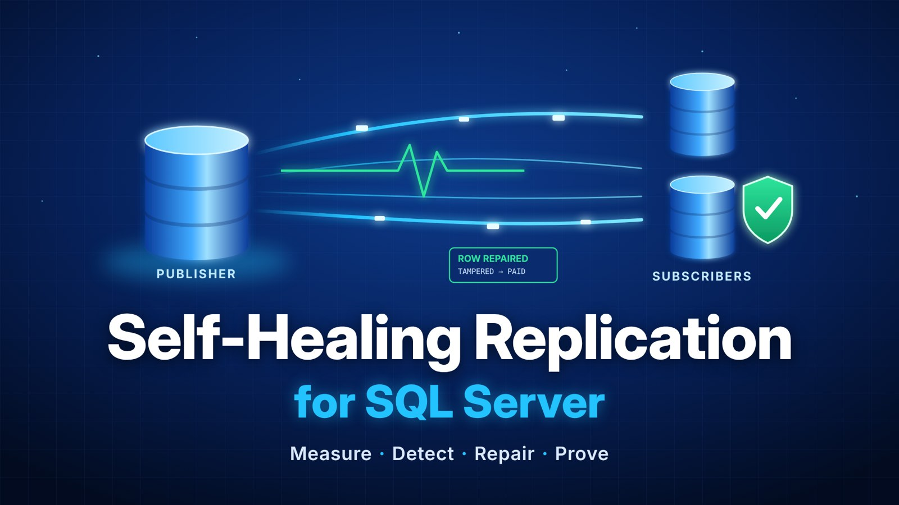
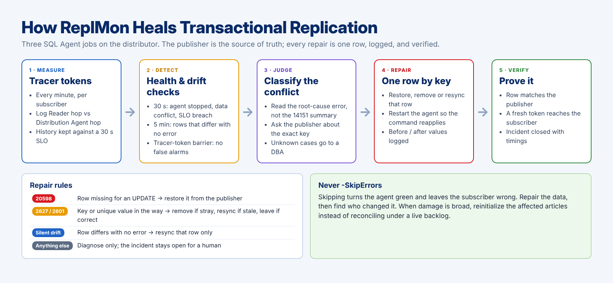
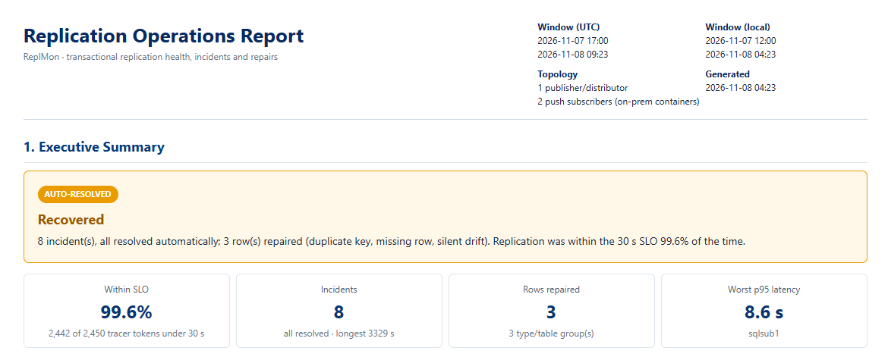
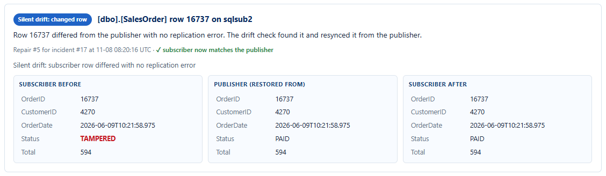
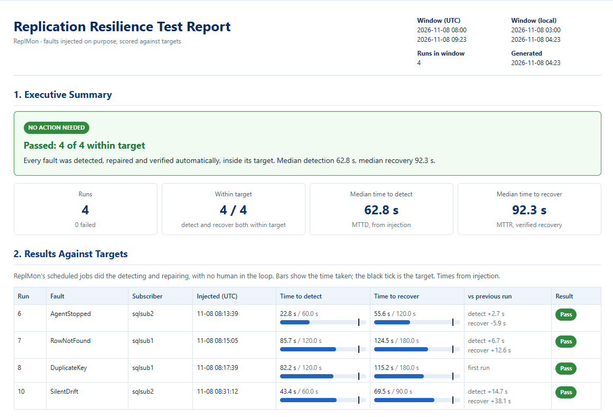
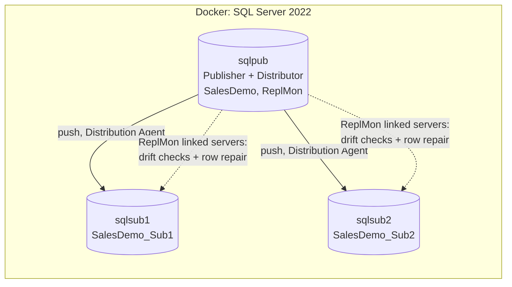

# Self-Healing Transactional Replication for SQL Server

A personally developed framework, **ReplMon**, that measures SQL Server transactional replication, repairs data conflicts row by row, finds silent drift that raises no error, and proves it with timed fault tests.

**Live sample reports (every section expanded):** [Operations report](https://lachungo.github.io/sql-server-self-healing-replication/operations-report.html) · [Resilience report](https://lachungo.github.io/sql-server-self-healing-replication/resilience-report.html)

**Article:** [How I Built Self-Healing Transactional Replication for SQL Server](ARTICLE_LINK)

---

## The question it answers

Replication Monitor can stay green while a subscriber is quietly wrong: a row deleted by hand, a stray row inserted by an application, a value changed outside replication. Nothing fails until the next change touches that row, and some rows are never touched again.

> Which subscriber is wrong, which rows, since when, and can I prove it is fixed?

ReplMon complements Replication Monitor; it does not replace it.

| Replication Monitor asks | ReplMon asks |
|---|---|
| Are the agents running, and how far behind are they? | Is every subscriber's data right, how long did it take to get there, and what did we change to make it right? |

## Results from the lab

| Measure | Result |
|---|---|
| Latency SLO (30 s), 16-hour window under continuous OLTP load | **99.6%** of tracer tokens within SLO (2,442 of 2,450); worst p95 8.6 s |
| Faults injected on purpose | **4 of 4** detected, repaired and verified automatically, within target |
| Silent drift under live load | 1 tampered row found among ~23,000; **zero false alarms** after the tracer-token barrier |

| Fault injected | Detected | Recovered | Target (detect / recover) |
|---|---|---|---|
| Distribution Agent stopped | 22.8 s | 55.6 s | 60 s / 120 s |
| Row missing at the subscriber (20598) | 85.7 s | 124.5 s | 120 s / 180 s |
| Stray row holding a unique SKU (2627) | 82.2 s | 115.2 s | 120 s / 180 s |
| Row changed at the subscriber, no error | 43.4 s | 69.5 s | 60 s / 90 s |

Times are from injection to verified recovery: the row matches the publisher and a fresh tracer token has arrived.

## How it heals



Three SQL Agent jobs on the distributor, all plain T-SQL:

| Job | Every | Does |
|---|---|---|
| ReplMon - Tracer tokens | 1 min | Posts a tracer token and records latency per subscriber, split into Log Reader hop and Distribution Agent hop |
| ReplMon - Health check | 30 s | Agent stopped, agent failing on a data conflict, latency over SLO: opens an incident and repairs the known cases |
| ReplMon - Drift check | 5 min | Row counts and checksums, key-level diff on suspect tables, tracer-token barrier, then a row-level repair |

### Repair rules

The publisher is the source of truth. ReplMon reads the root-cause error (not the 14151 summary), repairs the one row it names, restarts the agent so the failed command reapplies, and logs the row before, on the publisher, and after.

| Error | What it means | Repair |
|---|---|---|
| 20598 | Row missing at the subscriber for an UPDATE | Restore that row from the publisher |
| 2627 on a primary key | A stale row blocks an INSERT | Remove it; the agent inserts the publisher's row |
| 2627 / 2601 on a unique constraint or index | Another row holds the same unique value | Publisher judges: stray → delete, stale → resync, same → no repair |
| Silent drift | Row differs with no error | Resync that row only |
| Anything else | Needs judgment | Diagnose only; the incident stays open for a DBA |

**Never `-SkipErrors`.** Skipping turns the agent green and leaves the subscriber wrong. When damage is broad, reinitialize the affected articles instead of reconciling under a live backlog.

## Two reports, two readers

Both open with a verdict (**Healthy**, **Recovered** or **Action needed**) and keep the evidence one click below.

```powershell
# What happened to replication between 1:25 AM and 2:35 AM? (local time in, UTC handled for you)
./reports/Export-OperationsReport.ps1 -From '2026-11-08 01:25' -To '2026-11-08 02:35'

# How did the last round of fault tests score against their targets?
./reports/Export-ResilienceReport.ps1 -Hours 2
```

- **Operations report** (real incidents): latency against the SLO, incidents, rows repaired counted by type, table and subscriber, and a before/after card per repaired row. Every repaired row is also written to CSV, so a 40-million-row table produces a summary, not 40 million cards. Chaos-test incidents are excluded and counted.
- **Resilience report** (faults injected on purpose): each run scored against `ReplMon.dbo.ChaosTarget`, the change since the previous run of the same fault, and a phase bar showing where the time went.

| Operations report | Silent drift repair | Resilience report |
|---|---|---|
|  |  |  |

## The lab



One publisher/distributor and two push subscribers, a continuous OLTP workload every 10 seconds, everything built from code with T-SQL, PowerShell 7 and dbatools.

### Prerequisites

- Docker Desktop (WSL 2 backend on Windows) with Compose v2
- PowerShell 7 and `Install-Module dbatools -Scope CurrentUser`

### Quick start

```powershell
Copy-Item .env.example .env          # set your own passwords; .env is git-ignored
./build-lab.ps1 -SkipMI              # containers, distributor, publication, subscriptions, ReplMon

# let latency collect for 15+ minutes, then break things on purpose
./chaos/Invoke-ChaosTest.ps1 -Scenario All -TriggerDriftNow

./reports/Export-OperationsReport.ps1 -Hours 2
./reports/Export-ResilienceReport.ps1 -Hours 1

./teardown-lab.ps1
```

Connect SSMS to `localhost,14331` (publisher), `localhost,14332` and `localhost,14333` (subscribers).

### What is in the repo

| Path | Purpose |
|---|---|
| `docker-compose.yml` | Publisher/distributor and two subscribers, SQL Server 2022, Agent enabled, fixed hostnames |
| `build-lab.ps1` / `teardown-lab.ps1` | One-command build and teardown |
| `sql/01-04` | Demo database and workload, distributor, publication, push subscriptions |
| `sql/10-replmon.sql` | The framework: tracer collector, health check, drift check, row-level repair, incident and repair logs, chaos targets, Agent jobs |
| `sql/11-register-subscriber.sql` | ReplMon linked server and subscriber registry |
| `chaos/Invoke-ChaosTest.ps1` | Fault injection and timing: AgentStopped, RowNotFound (20598), DuplicateKey (2627), SilentDrift |
| `reports/` | Operations and resilience report generators (self-contained HTML) |
| `infra/` | Optional Azure SQL Managed Instance subscriber (not part of the measured results) |
| `docs/` | Sample reports served by GitHub Pages, and the images above |

## Design decisions

**One destination database per subscriber.** Each subscription maps to exactly one row in `MSdistribution_agents`, so latency, errors and jobs line up per subscriber.

**`immediate_sync = false`, `allow_anonymous = false`.** New articles can be added later and only those articles are snapshotted.

**`schema_option 0x803509B` and `identityrangemanagementoption = 'none'`.** Subscriber tables are created without IDENTITY, so a repair can re-insert a missing key. With `'manual'`, replication re-creates IDENTITY and overrides the schema option, and it cannot be changed after the article exists.

**Follow the error chain.** `MSdistribution_history.error_id` points at the 14151 summary; the real cause (20598, 2627) is in `MSrepl_errors` under the next id.

**Tracer token as a consistency barrier.** A key counts as drift only if the publisher row did not change between two passes and the subscriber still differs after a tracer token has arrived. In-flight rows can't raise a false alarm.

**Repair the row, not the table.** Reconciling a whole table while the agent has a backlog copies rows early, and the agent then fails on every one with duplicate keys. Repair the row named in the error, or stop the agent and drain first, or reinitialize.

## What I got wrong first

1. My first detector looked at the 14151 row and never matched 20598, which sits on the next id.
2. `identityrangemanagementoption = 'manual'` silently re-created IDENTITY, so my repair could not insert the missing key.
3. A whole-table reconcile under a 450-command backlog caused a duplicate-key cascade. A repair that is faster than the replication stream will collide with it.

## Production hardening that remains

- Approval before repair on critical systems: auto-repair suits a reporting tier; a payments database deserves a human sign-off.
- `HASHBYTES` instead of `BINARY_CHECKSUM`, which can collide; `xml`, `text` and `image` columns are not compared.
- Key-range batching for large tables over linked servers.
- The 80-second gap: tracing why the Distribution Agent takes so long to surface a row-level error.
- An Azure SQL Managed Instance subscriber to measure the cloud hop.

Chaos tests belong in non-production or an agreed game-day window. The lab uses container names and synthetic data only.

---

**Louis Achungo** · Senior SQL Server DBA · SQL Server Architect · [LinkedIn](https://www.linkedin.com/in/louis-achungo) · [Portfolio](https://sql-it-techsolutions.com/)
